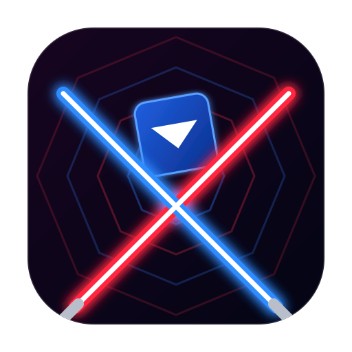
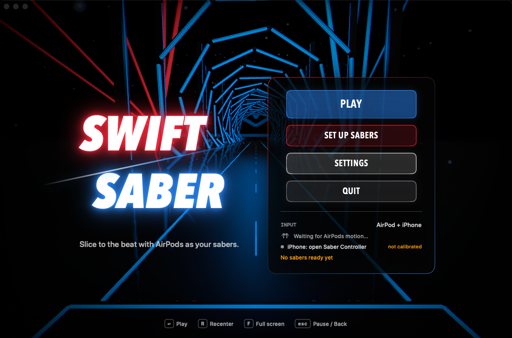
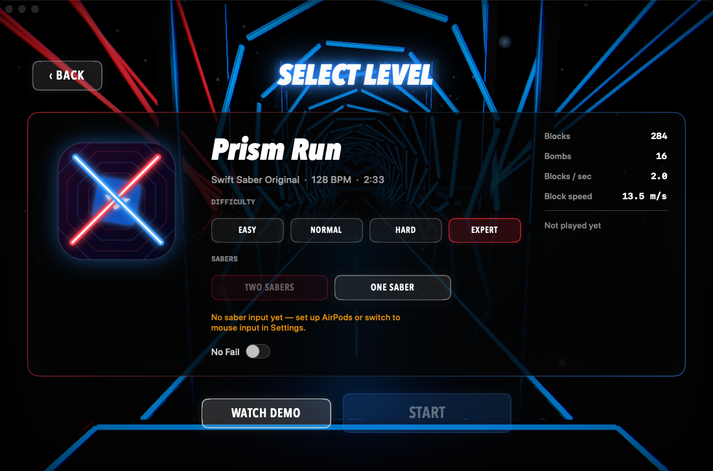
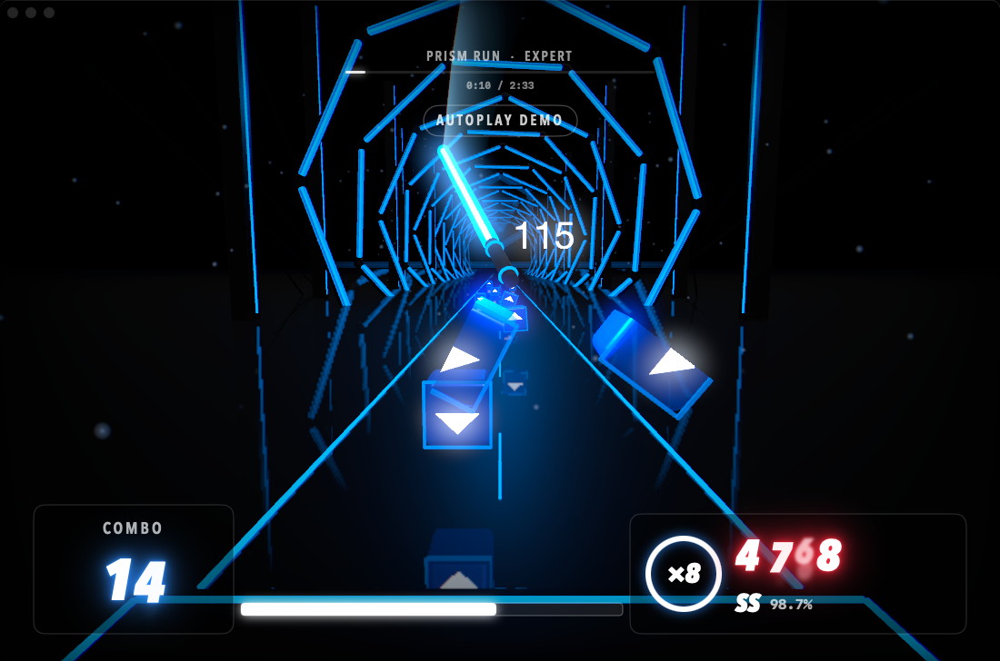

<p align="center">
  
</p>

<h1 align="center">Swift Saber</h1>

<p align="center">
  <b>A neon rhythm-slicing game for macOS where an AirPod and your iPhone are the sabers.</b>
</p>

<p align="center">
  <a href="https://github.com/tom-byrn/swift-saber/actions/workflows/build.yml"></a>
  
  
  
  
  
  
</p>

<p align="center">
  
</p>

## Overview

Swift Saber is a VR-style block-slicing rhythm game, rebuilt for a flat screen with no headset. Stand in front of your Mac with an **AirPod in one fist** and your **iPhone in the other**. Swing to slice the blocks flying at you, in the direction of their arrows and on the beat.

- **Motion controllers you already own.** One saber is driven by an AirPod's motion sensors. The other is driven by your iPhone running the companion **Swift Saber** iPhone app, which streams its motion over Wi-Fi at 100 Hz.
- **Calibration that works with any grip.** You point at the screen, then at the ceiling, then at the screen again. The game works out how each device sits in your hand.
- **An original soundtrack, "Prism Run".** A 128 BPM, 2½-minute electronic track that is composed and synthesized entirely in code: no samples, no licensed audio.
- **Four hand-designed difficulties** (Easy to Expert) plus One Saber maps. Blocks follow natural swing flow, with bombs and a light show synced to the music.
- **Full scoring.** Cuts score up to 115 points for swing-in, follow-through and accuracy. There's a ×1 to ×8 combo multiplier, an energy bar, ranks from SS to E, and saved personal bests.
- **Five arenas.** Prism Hall, Sunset Drive, Warp Tunnel, Neon Skyline and Orbit, each with its own geometry and light show synced to the music. All have HDR bloom, blocks that split into real halves, sparks and saber trails.
- **Your colours.** Swap red and blue for anything: a full RGB editor (sliders, hex codes or the macOS colour panel) for each saber and each side's lights, plus a dozen ready-made templates.
- **Watch Demo** plays any map with perfect autoplay sabers, so you can see how it flows first.

<table>
  <tr>
    <td></td>
    <td></td>
  </tr>
  <tr>
    <td></td>
    <td></td>
  </tr>
  <tr>
    <td></td>
    <td align="center"></td>
  </tr>
</table>

## Why an AirPod *and* an iPhone?

AirPods only stream motion from **one bud at a time** ([Apple, WWDC23](https://developer.apple.com/videos/play/wwdc2023/10179)), so a single pair can drive only one saber. The iPhone provides the second one. It also has advantages of its own:

- a compass, so its aim doesn't drift
- a faster update rate
- haptic feedback on every cut

### …or the whole AirPods case

With **AirPods Pro 2 or 3** you can leave both buds in their **closed charging case** and hold the case as the hilt: bigger, easier to grip, and no Automatic Ear Detection to switch off. Choose **Closed case** under *Hold the AirPods as* in Saber Setup or Settings. This uses the closed-case motion method from [AirPointer](https://github.com/musubipapi/airpointer) by Andy Gao (MIT). Its two Bluetooth helpers are bundled in [`Helpers/AirPodsCase`](Helpers/AirPodsCase).

| Input mode | Sabers |
| --- | --- |
| **AirPod + iPhone** (default) | Two: AirPod in your main hand, iPhone in the other |
| AirPod only / iPhone only | One: plays the One Saber maps |
| AirPod + Mouse | Two: the mouse or trackpad drives the second saber |
| Mouse / Trackpad | One: for playing or testing without devices |

## Getting started

### 1. Build the Mac game

Requires **macOS 14 Sonoma or later** and Xcode 15+ (or just the Command Line Tools: `xcode-select --install`).

```bash
./Scripts/build-app.sh --run
```

This builds, ad-hoc signs and launches `build/Swift Saber.app`. Use `--install` to copy it to `/Applications`. The first launch renders the soundtrack (a few seconds) and caches it.

Prefer not to build? Every push is built by GitHub Actions. Download the **SwiftSaber-app** artifact from the [latest run](https://github.com/tom-byrn/swift-saber/actions/workflows/build.yml), unzip it, and right-click › Open the first time.

### 2. Install Swift Saber on your iPhone

1. Open `iOSController/SaberController.xcodeproj` in Xcode.
2. Under **SaberController › Signing & Capabilities**, pick your Team (a free Apple ID works). If the bundle ID is taken, change it to anything unique.
3. Plug in your iPhone (iOS 17+), select it as the run destination and press **Run**. If asked, trust the developer profile on the phone under Settings › General › VPN & Device Management.

### 3. Get your devices ready

- **AirPods:** connect them to the Mac, then turn off **Automatic Ear Detection** (System Settings › *your AirPods*). Otherwise motion stops as soon as a bud leaves your ear. Hold **one** bud.
- **iPhone:** use the same Wi-Fi as the Mac and open the Swift Saber app. Allow **Local Network** access on both devices; the phone finds the game automatically.

#### Using the closed case instead

Saber Setup walks you through it:

1. **Get the case ready.** Both AirPods Pro go in the case, paired with the Mac. If they're also paired with your iPhone, turn the iPhone's Bluetooth off (the Swift Saber phone app uses Wi-Fi).
2. **Connect Case, then open the lid.** The first time, allow Bluetooth access.
3. **Close the lid.** This is usually detected automatically; otherwise press *Lid Is Closed*.
4. **Set it down** on a flat surface until the ring fills. This is only needed about once a week, because the sensor offset is saved.
5. **Pick it up.** Calibration then starts by itself.

Know what a session does before you use it. While connected, Mac sound and the microphone are kept off those AirPods, and silence is played to them to keep the link awake. Connecting briefly drops their audio, so don't connect during a call. Ending a session uses up diagnostic data stored on the case. A session lasts about **30 minutes** after the lid closes (a firmware limit); to keep playing, connect again. If the case saber points back at you, turn on **Flip case saber** in Settings. The phone mirrors every step, so you can connect from the iPhone too.

### 4. Calibrate and play

Choose **Set Up Sabers**, then point at the screen, at the ceiling, and at the screen again, holding still until each ring fills. After each pose, press **Next** (on screen, Return / Space, or the **NEXT** button on the iPhone) when you are ready for the next one. Live readouts show each device's orientation while you calibrate. Then hit **Play**.

## Controls

| Key | Action |
| --- | --- |
| `Return` | Play / start level / play again; in Saber Setup, start and go to the next pose |
| `Space` | Pause / resume (with a 3-2-1 countdown); in Saber Setup, next pose |
| `Esc` | Pause / resume; on other screens, back to the main menu |
| `R` (or `⇧⌘R`) | Recenter sabers (point at the screen centre first) |
| `F` | Toggle full screen |
| `⌘K` | Set up sabers |

Motion controls don't count as keyboard or mouse activity, so the game keeps the display awake while it is the frontmost app; once you switch away, the Mac sleeps as usual.

### Playing from your iPhone

You never need to walk back to the Mac. Once the iPhone app connects, the phone mirrors whatever the game is showing and gives you buttons for all of it:

- **Main menu:** Play, Set Up Sabers, Arena & Colors, Settings, Recenter, Quit
- **Level select:** difficulty, one/two sabers, arena, No Fail, Start, Watch Demo
- **Arena & Colors:** pick the arena, colour templates, edit each saber and light colour
- **Saber setup:** start, restart and finish calibration
- **Settings:** every option from the Mac's settings screen
- **In a song:** a big **hold-to-pause** button. Press and hold it for about a second to pause, so a swing or a brushed thumb never pauses by accident.
- **Paused / results:** Resume, Recenter, Restart, Play Again, Change Level, Menu

The phone works as a remote in every input mode, even when it isn't one of the sabers. AirPods have no compass, so their aim can slowly drift. With **Auto-recenter** on (the default), the sabers re-centre at every song start, so aim at the screen during the countdown.

### Arena & Colors

Open **Arena & Colors** from the main menu. The live arena stays visible behind the panels, so every change previews instantly (**Preview Lights** fires a burst of the light show).

| Arena | Look |
| --- | --- |
| **Prism Hall** | Mirrored runway through spinning octagonal prism rings and laser fans |
| **Sunset Drive** | Scrolling synthwave grid, a striped sun setting behind a city skyline, sun rays, solid wireframe mountains and neon palms |
| **Warp Tunnel** | A tunnel of square light frames that twists into a spiral, inside a cage of hex rings, with hyperspace streaks and a portal |
| **Neon Skyline** | A skybridge above a neon city of lit windows, billboards, blinking antennas and flying traffic, with searchlights and halos under a giant moon |
| **Orbit** | A floating platform in a nebula, a three-axis gyroscope, a ringed planet, turning space stations and crossing laser fans |

Sunset Drive, Warp Tunnel, Neon Skyline and Orbit each have a sky that lights their structures, and their lights never fade fully to black, so the space stays readable even during blackouts in the light show.

Each arena has its own colours. Turn on **Custom colors**, pick a template (Classic, Sunset, Synthwave, Toxic, Fire & Ice, Gold & Teal, Bubblegum, Emerald, Inferno, Deep Sea, Royal, Monochrome) or edit any of the four colours (left/right saber, left/right lights) with RGB sliders, a hex code or the system colour picker. Custom colours apply in every arena. You can also switch arenas from the level select screen.

### Tuning (Settings)

**Controls**

- **Input**: one of the input modes in the table above.
- **Hold the AirPods as**: *AirPod in hand* (one bud) or *Closed case*. With the case, **Flip case saber** fixes a saber that points back at you.
- **AirPod hand**: which hand holds the AirPod saber; the other saber goes in the other hand.
- **Saber sensitivity**: scales your wrist rotation.
- **AirPods motion delay**: how late Bluetooth motion arrives. Collisions are checked against where the blocks were when you actually swung.
- **Lenient cut angles** (on by default): accepts cuts within ±75° of the arrow instead of ±60°, and slower swings.
- **Auto-recenter when a song starts** (on by default).
- **Keep AirPods awake**: plays a silent stream so a held bud doesn't stop sending motion.

**Audio**

- **Play game audio on**: Mac speakers (recommended, low latency), the system default, or any output device.
- **Music volume** and **Effects volume**.
- **Audio offset**: shift the music if hits feel early or late.

**Visuals and gameplay**

- **Bloom & glow**, **Camera shake** and **No Fail**.

## How it works

```
Sources/
  SaberCore/               platform-independent, unit-tested game logic
    Math.swift               vectors and quaternions (no simd, so the core builds anywhere)
    Arena.swift              world layout: track, block grid, hit boxes, virtual shoulders
    Beatmap.swift            hands, cut directions, difficulties, notes and bombs
    Song.swift               arrangement of "Prism Run" (sections, chords, melody)
    MusicSynth.swift         offline synthesizer: drums, bass, pads, arps, lead, FX, reverb/delay
    SoundEffects.swift       synthesized slice, miss, bomb and menu sounds
    LevelDesigner.swift      rhythm per section/difficulty + swing-flow rules, light show
    Calibration.swift        three-pose calibration, quaternion-convention detection via gravity
    Swing.swift              pose prediction/smoothing for low-rate sensors, swing-arc tracking
    CaseMotion.swift         closed-case motion: sensor fusion, lid tracking, helper errors
    GameSession.swift        swept blade-vs-block collision, cut validation, misses, bombs
    Scoring.swift            cut score, combo/multiplier, energy, ranks
    Autoplay.swift           perfect-play driver for the demo and tests
    ControllerProtocol.swift phone ↔ Mac wire format (shared with the iPhone app)
    ColorScheme.swift        RGB colours, saber/light colour schemes and templates
  SwiftSaber/              macOS app
    App/                     app state machine, settings, iPhone-remote commands, code-drawn icon
    Input/                   AirPods motion, iPhone controller server (Bonjour + UDP), calibration flow
      AirPodsCase/             closed-case session, Bluetooth and audio guard
    Audio/                   AVAudioEngine playback, output-device routing (CoreAudio)
    Render/                  SceneKit arenas (Render/Arenas), blocks (clip-plane shader for real halves), sabers, effects
    UI/                      SwiftUI menus, setup, HUD, pause, results
Helpers/AirPodsCase/       AirPointer's closed-case Bluetooth helpers (built into the app bundle)
iOSController/             Swift Saber iPhone app (Xcode project "SaberController"; SwiftUI, Core Motion, Network)
Scripts/build-app.sh       builds, bundles and ad-hoc signs the Mac app
```

AirPods and phones report orientation, not position, so each saber pivots from a virtual shoulder. Aiming moves the blade across the block grid, and swinging through a block cuts it. Blade sweeps between frames are sub-sampled, so fast swings still connect at low sensor rates.

Run the core tests with `swift test`. One of them auto-plays every difficulty and checks that each block can be cut cleanly. CI also builds the iPhone app and launches the game in autoplay mode to screenshot every screen; the screenshots above come from those runs.
