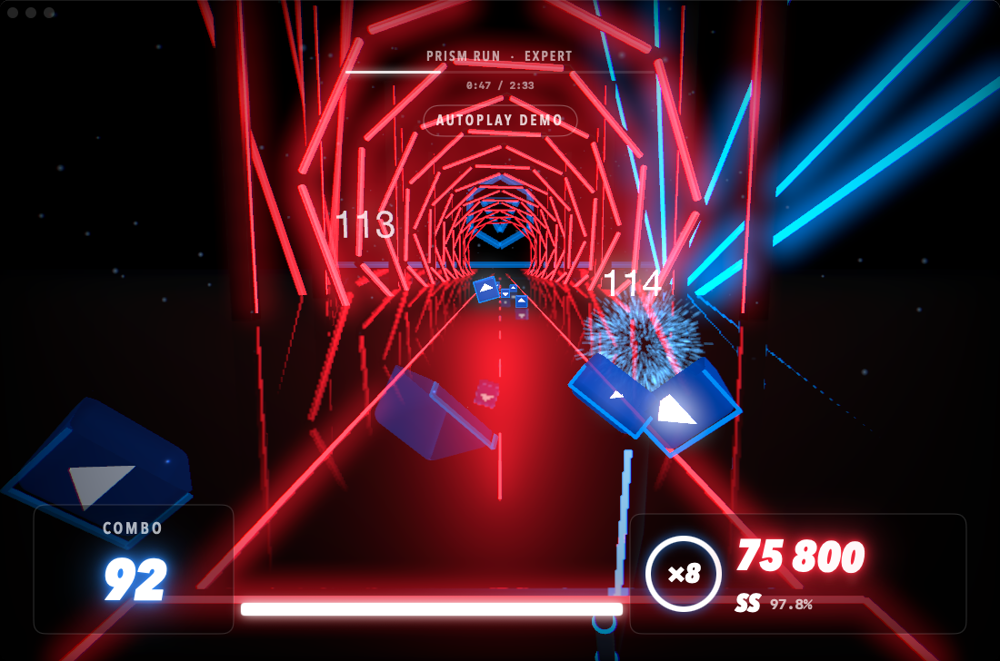
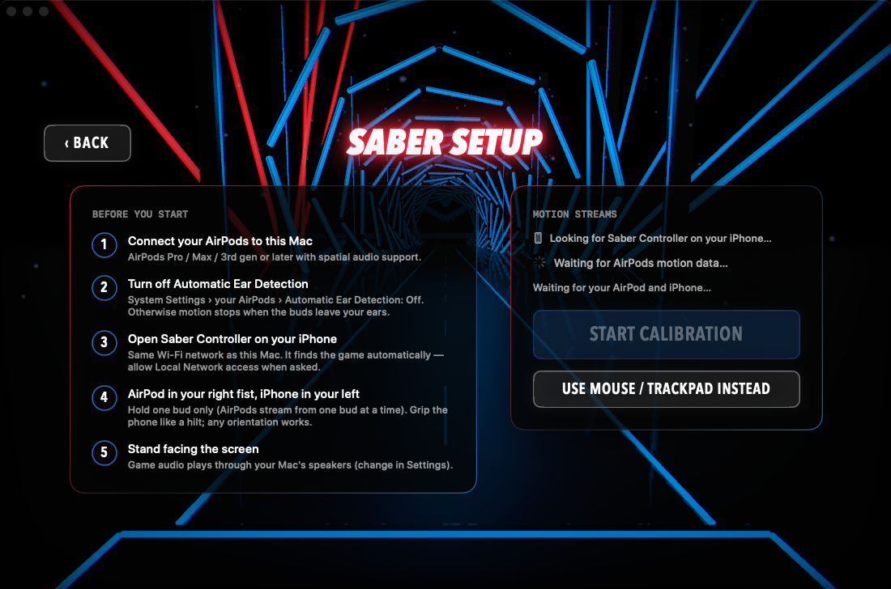
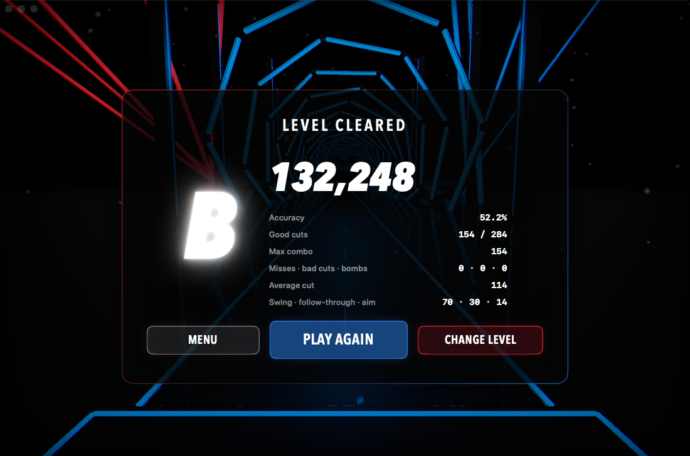
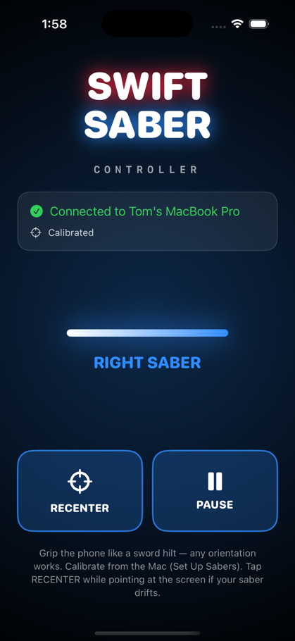

<p align="center">
  
</p>

<h1 align="center">Swift Saber</h1>

<p align="center">
  <b>A neon rhythm-slicing game for macOS where an AirPod and your iPhone are the sabers.</b>
</p>

<p align="center">
  <a href="https://github.com/tom-byrn/swift-saber/actions/workflows/build.yml"></a>
  
  
  
  
  
  
</p>

<p align="center">
  
</p>

## Overview

Swift Saber is a VR-style block-slicing rhythm game, rebuilt for a flat screen with no headset. Stand in front of your Mac with an **AirPod in one fist** and your **iPhone in the other**. Swing to slice the blocks flying at you, in the direction of their arrows and on the beat.

- **Motion controllers you already own.** One saber is driven by an AirPod's motion sensors. The other is driven by your iPhone running the companion **Saber Controller** app, which streams its motion over Wi-Fi at 100 Hz.
- **Calibration that works with any grip.** You point at the screen, then at the ceiling, then at the screen again. The game works out how each device sits in your hand.
- **An original soundtrack, "Prism Run".** A 128 BPM, 2½-minute electronic track that is composed and synthesized entirely in code: no samples, no licensed audio.
- **Four hand-designed difficulties** (Easy to Expert) plus One Saber maps. Blocks follow natural swing flow, with bombs and a light show synced to the music.
- **Full scoring.** Cuts score up to 115 points for swing-in, follow-through and accuracy. There's a ×1 to ×8 combo multiplier, an energy bar, ranks from SS to E, and saved personal bests.
- **A neon stage.** HDR bloom, a reflective runway, rotating prism rings, laser fans, blocks that split into real halves, sparks and saber trails.
- **Watch Demo** plays any map with perfect autoplay sabers, so you can see how it flows first.

<table>
  <tr>
    <td></td>
    <td></td>
  </tr>
  <tr>
    <td></td>
    <td></td>
  </tr>
  <tr>
    <td></td>
    <td align="center"></td>
  </tr>
</table>

## Why an AirPod *and* an iPhone?

AirPods only stream motion from **one bud at a time** ([Apple, WWDC23](https://developer.apple.com/videos/play/wwdc2023/10179)), so a single pair can drive only one saber. The iPhone provides the second one. It also has advantages of its own:

- a compass, so its aim doesn't drift
- a faster update rate
- haptic feedback on every cut

| Input mode | Sabers |
| --- | --- |
| **AirPod + iPhone** (default) | Two: AirPod in your main hand, iPhone in the other |
| AirPod only / iPhone only | One: plays the One Saber maps |
| AirPod + Mouse | Two: the mouse or trackpad drives the second saber |
| Mouse / Trackpad | One: for playing or testing without devices |

## Getting started

### 1. Build the Mac game

Requires **macOS 14 Sonoma or later** and Xcode 15+ (or just the Command Line Tools: `xcode-select --install`).

```bash
./Scripts/build-app.sh --run
```

This builds, ad-hoc signs and launches `build/Swift Saber.app`. Use `--install` to copy it to `/Applications`. The first launch renders the soundtrack (a few seconds) and caches it.

Prefer not to build? Every push is built by GitHub Actions. Download the **SwiftSaber-app** artifact from the [latest run](https://github.com/tom-byrn/swift-saber/actions/workflows/build.yml), unzip it, and right-click › Open the first time.

### 2. Install Saber Controller on your iPhone

1. Open `iOSController/SaberController.xcodeproj` in Xcode.
2. Under **SaberController › Signing & Capabilities**, pick your Team (a free Apple ID works). If the bundle ID is taken, change it to anything unique.
3. Plug in your iPhone (iOS 17+), select it as the run destination and press **Run**. If asked, trust the developer profile on the phone under Settings › General › VPN & Device Management.

### 3. Get your devices ready

- **AirPods:** connect them to the Mac, then turn off **Automatic Ear Detection** (System Settings › *your AirPods*). Otherwise motion stops as soon as a bud leaves your ear. Hold **one** bud.
- **iPhone:** use the same Wi-Fi as the Mac and open Saber Controller. Allow **Local Network** access on both devices; the phone finds the game automatically.

### 4. Calibrate and play

Choose **Set Up Sabers**, then point at the screen, at the ceiling, and at the screen again, holding still until each ring fills. Then hit **Play**.

## Controls

| Key | Action |
| --- | --- |
| `Return` | Play / start level |
| `Esc` or `Space` | Pause / resume (with a 3-2-1 countdown) |
| `R` | Recenter sabers (point at the screen centre first) |
| `F` | Toggle full screen |
| `⌘K` | Set up sabers |

The iPhone also has big **Recenter** and **Pause** buttons. AirPods have no compass, so their aim can slowly drift. With **Auto-recenter** on (the default), the sabers re-centre at every song start, so aim at the screen during the countdown.

### Tuning (Settings)

- **Saber sensitivity**: scales your wrist rotation.
- **AirPods motion delay**: how late Bluetooth motion arrives. Collisions are checked against where the blocks were when you actually swung.
- **Audio offset**: shift the music if hits feel early or late.
- **Lenient cut angles**: accepts cuts within ±75° of the arrow instead of ±60°.
- **Play game audio on**: Mac speakers (recommended, low latency), the system default, or any output device.

## How it works

```
Sources/
  SaberCore/               platform-independent, unit-tested game logic
    Song.swift               arrangement of "Prism Run" (sections, chords, melody)
    MusicSynth.swift         offline synthesizer: drums, bass, pads, arps, lead, FX, reverb/delay
    LevelDesigner.swift      rhythm per section/difficulty + swing-flow rules, light show
    Calibration.swift        three-pose calibration, quaternion-convention detection via gravity
    Swing.swift              pose prediction/smoothing for low-rate sensors, swing-arc tracking
    GameSession.swift        swept blade-vs-block collision, cut validation, misses, bombs
    Scoring.swift            cut score, combo/multiplier, energy, ranks
    Autoplay.swift           perfect-play driver for the demo and tests
    ControllerProtocol.swift phone ↔ Mac wire format (shared with the iPhone app)
  SwiftSaber/              macOS app
    Input/                   AirPods motion, iPhone controller server (Bonjour + UDP), calibration flow
    Audio/                   AVAudioEngine playback, output-device routing (CoreAudio)
    Render/                  SceneKit stage, blocks (clip-plane shader for real halves), sabers, effects
    UI/                      SwiftUI menus, setup, HUD, pause, results
iOSController/             Saber Controller iPhone app (SwiftUI, Core Motion, Network)
```

AirPods and phones report orientation, not position, so each saber pivots from a virtual shoulder. Aiming moves the blade across the block grid, and swinging through a block cuts it. Blade sweeps between frames are sub-sampled, so fast swings still connect at low sensor rates.

Run the core tests with `swift test`. One of them auto-plays every difficulty and checks that each block can be cut cleanly. CI also builds the iPhone app and launches the game in autoplay mode to screenshot every screen; the screenshots above come from those runs.
